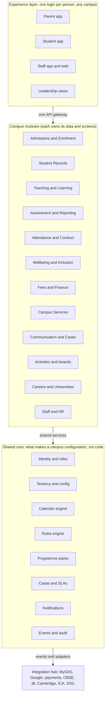
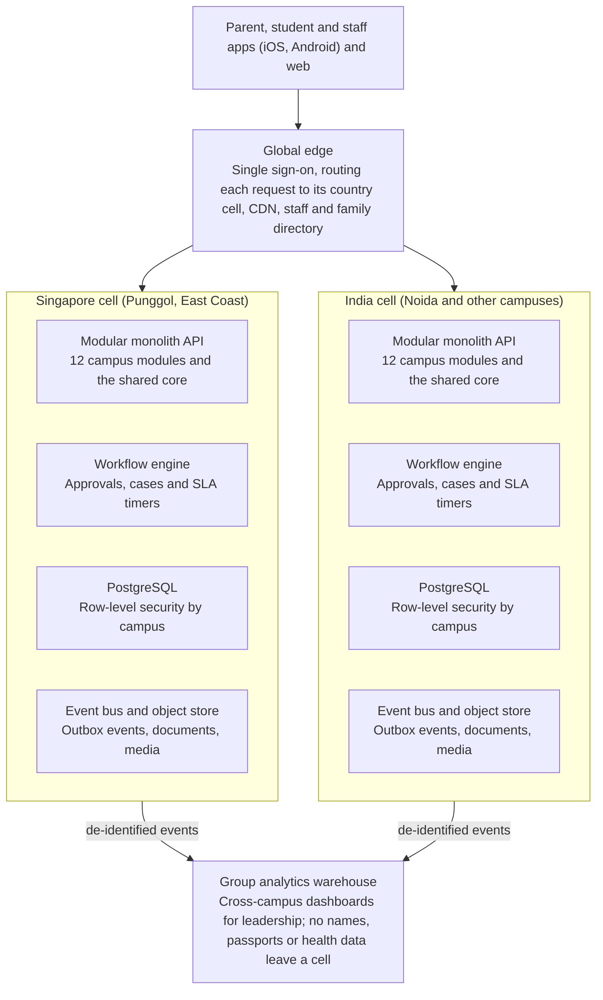
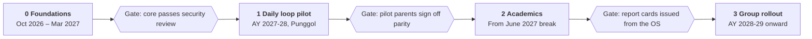

# Global Campus OS — Product Architecture v1.0 (Product Truth)

**Status:** Proposed architecture for review; drafted 4 October 2026, published to product truth 18 October 2026.
**Owner:** Henry.
**Scope:** The whole Global Campus OS for GIIS: apps, campus modules, shared core, tenancy, data model, integrations, security and roadmap.
**Source doc:** [GIIS Global Campus OS: Product Architecture](https://claude.ai/code/artifact/b21ca24d-e0c2-4031-ab6f-209790606db6) (live doc; this file is the versioned copy).

## How to use this document (for AI-assisted design)

This file is the canonical description of *what the product is*. The design system (`design-tokens/`, `prompts/system.md`) says *how it looks*. When generating or reviewing a screen:

- **Vocabulary.** Use the module, role, entity and workflow names exactly as written here (for example "Communication and Cases", "Programme coordinator", "Case", "Programme pack"). Don't invent new module names or navigation groups.
- **Navigation.** The 12 campus modules in [Domains and modules](#domains-and-modules) are the top-level navigation for staff surfaces; a role only sees the modules its scope allows ([Users and roles](#users-and-roles)).
- **Campus context.** Every staff screen is scoped to a tenant (Group > Country > Campus > Section). Show the current campus or scope in the shell, and never hard-code one campus's calendar, grading scale, currency or regulator into a screen.
- **Realistic content.** Use GIIS facts from [How GIIS operates today](#how-giis-operates-today) (curricula, calendars, thresholds, SLAs) for placeholder data. People and student names stay synthetic.
- **Sensitive data.** Tier 3 data (identity documents, health, SEN, counselling, child protection) is shown only to named roles and should look visibly restricted in designs ([Security, privacy and compliance](#security-privacy-and-compliance)).
- **Design direction.** Files `00-` to `06-` in this folder are the design layer: working assumptions that let screens be designed now and are expected to change. They never override this document. When one is confirmed, it is written into this document and its entry in `06-decision-log.md` is marked Confirmed.
- **Status.** Tech-stack choices and roadmap dates are recommendations, not decisions. Items in [Open questions](#open-questions) are unresolved; don't design them as if settled.

Related product truth: [Employee Data Dictionary v1](./Global_Campus_OS_Employee_Data_Dictionary_v1.md) (employee master data and GA/TM access management; it refines the *Staff and HR* module and the *Identity and roles* core service below).

## Summary

Build the Global Campus OS as one multi-tenant platform where every campus is configuration, not a fork: a Group > Country > Campus > Section hierarchy, curricula as pluggable programme packs, and school policies as rules the system enforces. GIIS already runs five curricula, two very different calendars and two regulators across just the two cities in our files, so anything hard-coded to one campus will break at the second.

Five architectural bets carry the design:

1. **Campus as configuration.** Singapore and Noida share one codebase and one data model. Differences (calendar, holidays, fees, regulators, language options) live in campus and country settings.
2. **Programme packs.** CBSE, IB PYP, IB DP, Cambridge CLSP, IGCSE and Global Montessori Plus each ship as a pack: grade levels, subjects, assessment types, grading scale, promotion rules and report card templates.
3. **Policy as rules.** Attendance thresholds, promotion criteria, refund tables and complaint deadlines from the handbook become versioned rules with alerts, not PDF text people have to remember.
4. **A campus calendar engine.** Holidays, vacations, exam windows, PTMs and events are scoped by campus and by segment (Pre-Primary, Primary, Middle, Higher), and everything else (attendance, timetables, fee billing, notifications) reads from it.
5. **Evolve MyGIIS, don't replace it overnight.** The parent portal's existing features become the first release of the new parent app, migrated module by module behind the same login.

## How GIIS operates today

The four project files show the same school brand running on different calendars, curricula mixes and regulators in each country. The platform has to hold all of these side by side.

| Dimension | Singapore (SMART Campus Punggol, East Coast) | Noida |
|---|---|---|
| Source | Student Handbook 2025-26; Holiday and Exam Schedules 2026-27 | Almanac 2025-26 |
| Curricula | GMP (KG), CBSE 1-12, IB PYP, CLSP 6-8, IGCSE 9-10, IBDP | CBSE-led; segments Pre-Primary, Primary (1-5), Middle (6-8), Higher (9-12) |
| Academic year | Two semesters; 196 study days and 85 holiday days in 2026-27 | Starts 7-8 April 2025, staggered by grade band |
| Vacations | June (13 Jun-12 Jul), Sem 1 break, December (5 Dec-3 Jan), Sem 2 break | Summer vacation from 19 May (PP-G8) and 28 May (G9-12) |
| Holidays | Singapore public holidays plus Indian Independence and Republic Day; Monday in lieu rule | Indian national and festival holidays; Saturdays marked NWD (non-working day) |
| Assessment rhythm | CBSE Periodic Tests, Half Yearly, Yearly; CBSE 11-12 Cyclic Tests; IGCSE and CLSP semester exams; IBDP | PT1, Pre-Mid Term, CT1 per grade band, held in weekday windows |
| School day | 9:00-3:40 (Grades 1-12); KG 9:00-12:30 or extended to 3:30 | Not stated in the almanac |
| Regulator | SSG/CPE, EduTrust, Fee Protection Scheme, ICA Student Pass, MOE for citizens | CBSE affiliation |
| Parent channel | MyGIIS portal, school diary, helpdesk | Almanac, PTMs on Saturdays |

Rules in the handbook that the system must enforce or automate:

- **Attendance.** 90% minimum for Student Pass holders, 85% for others in most promotion rules; ICA is notified when a Student Pass holder is absent more than 7 consecutive days; leave over 2 days needs Principal approval.
- **Grading.** CBSE board bands by eighths (A1 to E), CBSE co-scholastic 5-point scale, IB 1-7 with category thresholds, IGCSE and CLSP grade scales.
- **Promotion.** Weak pass and conditional promotion with re-tests; IB Year 1 to Year 2 gates.
- **Appeals.** Re-evaluation requests within two days, results in six working days, no second appeal.
- **Refunds.** Cooling-off of 7 working days, Table 3A and 3B percentages, term billing in 4-month blocks, approval by Country Director and Finance Controller.
- **Complaints.** Acknowledge in 2 working days, close in 7, escalate at 14 and 21, then the CPE dispute scheme.
- **Discipline and devices.** Escalating actions from counselling to suspension, with parent notification at each step.

MyGIIS already offers Calendar, Exam and Results, Fees History, Directory, Messaging, PTM booking, Profile Update (passport and immigration status), School Bus requests, Syllabus, Timetable and Worksheets. That list is the baseline the new parent experience must match on day one.

## Users and roles

Access is role plus scope: the same role (say, Coordinator) is granted at a level of the hierarchy (a programme and grade band on one campus), and permissions flow down from there. The roles below are the ones the handbook names in its contact lists and escalation paths.

| Role | Scope | What they do in the OS |
|---|---|---|
| Group leadership | All countries | Cross-campus dashboards, programme pack and policy templates |
| Country Director | Country | Refund approvals, Dispute Resolution Committee chair, regulator reporting |
| Finance Controller | Country | Fee plans, invoicing, refunds, escalations within 24 hours |
| Campus Principal / Vice Principal / Deputy Principal | Campus or section | Approvals (leave over 2 days, suspensions, promotion), complaint escalation, campus analytics |
| Academic Supervisor | Campus | Assessment calendars, moderation, predicted grade committee |
| Programme or level coordinator | Programme and grade band (for example IBDP, CBSE 11-12, IGCSE 9-10, PYP, KG) | Timetables, results release, appeals, early leave approval |
| Class teacher | Section | Daily attendance, leave intake, parent messages, PTM slots |
| Subject teacher | Subject and sections | Lesson plans, homework, worksheets, marks entry, predicted grades |
| Counsellor (career, behavioural, SEN) | Campus | Counselling records, IEPs and access arrangements, LORs, university applications |
| Admissions and customer relations | Campus or country | Enquiries, enrolment, Student Pass cases, medical insurance claims, parent logins |
| Transport executive | Campus | Routes, bus start and stop requests, rider manifests |
| Nurse | Campus | Sick bay visits, medication, parent calls |
| ECA / CCA in-charge | Campus | Clubs, competitions, house activities, awards nominations |
| Security / reception | Campus | Late sign-in, out pass, visitor log |
| Discipline committee | Campus | Incident cases, warnings, suspension decisions |
| Parent / guardian | Own children, across campuses | Everything MyGIIS does today plus payments, consents and leave requests |
| Student | Self | Timetable, homework, LMS, results, house points, portfolio |

## Domains and modules

Twelve campus modules cover the school's day-to-day operation; all of them sit on eight shared core services, and that core is where multi-campus behaviour lives.

**Apps (4)** — thin clients over the same APIs.

| App | Primary users |
|---|---|
| Parent app | Parents / guardians |
| Student app | Students |
| Staff app and web | Teachers, coordinators, admin, services staff |
| Leadership views | Principals, Country Directors, Group leadership |

**Campus modules (12)** — each owns its own data and screens.

| # | Module | Covers |
|---|---|---|
| 1 | Admissions and Enrolment | Enquiry, application, AEPP; contracts, Student Pass cases |
| 2 | Student Records | Profiles, families, documents; transfers across campuses |
| 3 | Teaching and Learning | Timetables, lessons, homework; syllabus, worksheets, LMS |
| 4 | Assessment and Reporting | Exam calendars, marks; grades, report cards, appeals |
| 5 | Attendance and Conduct | Daily marks, leave, gate log; incidents, sanctions, houses |
| 6 | Wellbeing and Inclusion | Sick bay, counselling, SEN; access arrangements, safety |
| 7 | Fees and Finance | Fee plans, term invoices; refunds, scholarships, FPS |
| 8 | Campus Services | Transport, bookshop, canteen; rooms, assets, visitors |
| 9 | Communication and Cases | Messages, PTMs, announcements; feedback and complaint cases |
| 10 | Activities and Awards | ECA/CCA, house events; competitions, school awards |
| 11 | Careers and Universities | Counselling from grade 6; LORs, predicted grades |
| 12 | Staff and HR | Staff records, allocation; cover, training, appraisal (see the [Employee Data Dictionary](./Global_Campus_OS_Employee_Data_Dictionary_v1.md)) |

**Shared core services (8)** — Identity and roles · Tenancy and config · Calendar engine · Rules engine · Programme packs · Cases and SLAs · Notifications · Events and audit.

A module never hard-codes a calendar, grading scale or threshold: it asks the calendar engine, programme pack or rules engine for the current campus and date. The four apps are thin clients over the same APIs, so a feature built once reaches parents, students and staff on every campus.

## Key workflows

Each workflow below is lifted from a handbook policy; the OS turns it into a tracked case with owners, deadlines and an audit trail.

**Absence and leave**

1. Parent submits leave in the app, with a medical certificate for medical leave.
2. The system routes it by length: class teacher for 1-2 days, Principal for pre-planned leave over 2 days.
3. Attendance is marked by period or by day; late arrivals and early exits come from the security desk sign-in and out pass.
4. The rules engine projects each student's attendance against their threshold (90% Student Pass, 85% others) and warns teacher, coordinator and parent early.
5. For a Student Pass holder absent more than 7 consecutive days, a case opens for the ICA notification with the evidence attached.

**Assessment to report card**

1. The coordinator publishes the assessment calendar for a programme and grade band (for example CBSE 6-8 Periodic Test 1 on Tuesdays from 19 May).
2. The calendar engine checks clashes with holidays, other grades sharing invigilators, and the June and December vacations.
3. Teachers enter marks or run the test in the online exam portal; moderation and lock follow.
4. The programme pack converts marks to grades (CBSE eighths, IB 1-7 thresholds, IGCSE scale) and applies promotion rules.
5. Results release to parents; the appeal window opens for two days and each appeal is tracked to its six-working-day decision.

**Fees, withdrawal and refund**

1. Fee plans are set per campus and programme and billed in 4-month terms.
2. A withdrawal request starts a case: notice date, cooling-off check, applicable refund table (3A or 3B), documents checklist.
3. Missing documents trigger the 3-day notice and 7-day deadline automatically.
4. Country Director and Finance Controller approve in the app; the system tracks the 7-working-day refund deadline and escalation.

**Feedback and complaints**

1. A complaint arrives from the app, email or helpdesk and becomes a case.
2. Acknowledgement goes out within 2 working days, and the case routes to its process owner.
3. Deadlines escalate it automatically: closed within 7 working days, supervisor at 14, Dispute Resolution Committee at 21, then the CPE scheme.
4. Compliments and suggestions roll into the campus improvement review.

**Admission to enrolment**

1. Enquiry, application and assessment (including AEPP placement for English learners).
2. Offer, contract, registration fee; the cooling-off clock starts at signature.
3. Student Pass or MOE approval case where needed; refund rules if it is rejected.
4. On enrolment the student gets a section, timetable, bus route and logins for the parent and student apps.

## Multi-campus and tenancy model

Use one shared platform with a tenant key on every row (Group, then Country, then Campus), and keep data inside its country's region. Settings inherit downward, so a campus overrides only what is truly different.

| Level | Examples | Owns and can override |
|---|---|---|
| Group | GIIS group | Programme pack masters, brand, core policies, group analytics |
| Country | Singapore, India, each new country | Data region, regulator pack, currency and tax, public holidays, refund and fee protection rules, languages offered |
| Campus | SMART Campus Punggol, East Coast, Noida | Calendar, fee plans, buildings and rooms, transport routes, contacts and escalation owners |
| Section | Pre-Primary, Primary, Middle, Higher; or Primary and Secondary campus | School day timings, assembly days, segment-specific events |
| Programme offering | CBSE 6-8 at Punggol, IGCSE 9-10 at East Coast | Subjects, assessment calendar, grading scale version, promotion rule version |

Design rules for the hierarchy:

- **Region pinning.** Singapore data stays in a Singapore region and Indian data in an Indian region, each as its own deployment cell of the same code. A thin global layer holds only identity, directory and anonymised group analytics.
- **Families span campuses.** A parent account links to children on any campus or country, so a transfer from Noida to Singapore is a record move, not a new login.
- **Effective dating.** Every policy, fee plan and grading scale has a valid-from date, so 2025-26 report cards keep using 2025-26 rules after the 2026-27 handbook changes them.
- **Regulator packs.** Singapore ships with ICA Student Pass tracking, CPE/SSG EduTrust reports, Fee Protection Scheme and medical insurance records; India ships with CBSE affiliation data and board registration exports. A new country adds a pack, not a fork.
- **Localisation.** Currency, tax (GST), date formats and the second and third languages offered (Hindi, Tamil, French, Mandarin, Sanskrit) are per country or campus.

## High-level data model

The core is a small set of shared entities that every module reads; each module then owns its own tables. Every row carries `tenant_path` (group/country/campus) and, where rules apply, a `valid_from` date.

| Area | Core entities | Notes |
|---|---|---|
| Organisation | Group, Country, Campus, Section, Building, Room | Rooms from the classroom allocation lists (for example Block B #02-01A) feed timetabling |
| People | Person, Student, Guardian, Staff, Family link, Role grant (role + scope) | One Person can be a parent on one campus and staff on another |
| Identity documents | Passport, Immigration status, Student Pass, Medical certificate | Restricted fields; changes logged, as the handbook requires parents to keep these current |
| Academic structure | Academic year, Term, Programme pack, Grade level, Subject, Section (class), Enrolment | Enrolment links Student to Section and subject choices for a year |
| Calendar | Calendar, Event, Holiday, Vacation, Exam window, PTM slot | Each event scoped to campus plus segment or grade band |
| Teaching | Timetable, Period, Lesson plan, Homework, Worksheet, Syllabus unit | Syllabus is "test wise" today, so units link to assessments |
| Assessment | Assessment, Component, Mark, Grade scale, Grade, Report card, Appeal, Predicted grade | Grade scales are versioned per programme pack |
| Attendance and conduct | Attendance mark, Leave request, Gate log, Incident, Sanction, House points | Gate log covers late sign-in and out pass |
| Wellbeing | Sick bay visit, Counselling note, SEN profile, Access arrangement | Most restricted tier |
| Finance | Fee plan, Invoice, Payment, Refund case, Scholarship, Insurance policy | Term billing in 4-month blocks; FPS insurer and medical insurer recorded |
| Services | Route, Stop, Bus subscription, Bookshop order, Canteen | Bus start and stop requests from MyGIIS |
| Engagement | Message, Announcement, Case (complaint, appeal, withdrawal), Survey, Consent | Case is one shared object with SLA timers |
| Rules | Policy, Rule version, Threshold | Attendance, promotion, refund and SLA logic live here |

Three patterns keep this manageable across campuses:

- **One Case object** for complaints, appeals, withdrawals, leave over 2 days and Student Pass issues, each with type-specific fields and SLA timers.
- **Event log alongside tables.** Every change emits an event (attendance marked, marks locked, invoice paid), which feeds notifications, analytics and audit without coupling modules.
- **Programme pack as data.** Adding IB MYP or a new board means loading a pack (levels, subjects, scale, rules, templates), not writing a new module.

## System architecture and tech stack

Start as a modular monolith deployed once per country, not as dozens of microservices. A school group needs strong module boundaries and data residency far more than independent scaling, and a small team can run one deployable per region.

The global edge only knows who a person is and which cell holds their data; everything about a student stays in that student's country cell.

| Layer | Recommendation | Why |
|---|---|---|
| Mobile apps | React Native (one codebase for parent, student and staff roles) | Shares types and components with the web app |
| Web | Next.js with a shared design system | Staff-heavy screens (timetables, marks entry) work best on web |
| Backend | TypeScript (NestJS) modular monolith, one module per domain | One language front to back; modules can split into services later |
| Database | PostgreSQL with row-level security on `tenant_path` | Strong tenancy isolation without a database per campus |
| Workflows | Temporal (or a similar durable workflow engine) | Reliable SLA timers for complaints, refunds, appeals and ICA cases |
| Rules | Versioned rules tables, evaluated by a rules service (for example JSON Logic or OPA) | Policy changes become configuration with effective dates |
| Events | Transactional outbox to a managed queue (Kafka or Pub/Sub) | Feeds notifications, audit and analytics without coupling modules |
| Search and files | OpenSearch; object storage for documents and media | Directory, student search, worksheets, certificates |
| Identity | OIDC with Google Workspace for staff and students; passkey or OTP for parents | Matches GIIS's existing GSuite use |
| Analytics | Cloud warehouse (BigQuery or Snowflake) with a semantic layer | Group dashboards across campuses on de-identified data |
| Hosting | Managed Kubernetes or containers on one cloud, Singapore and India regions | Data residency with one operations model |
| Notifications | Push, email, SMS and WhatsApp through one notification service | Parent preferences per channel and language |

## Integrations

Integrate through one integration hub (adapters behind an internal API and event bus), so a campus swapping a vendor touches one adapter, not every module. The handbook already names several tools in use.

| Integration | Used for | Direction | Phase |
|---|---|---|---|
| MyGIIS (existing portal) | Logins, profiles, messaging, results history during migration | Two-way sync, then retire | 1 |
| Google Workspace (GSuite) | SSO for staff and students, Classroom, Drive, Meet | Two-way | 1 |
| Zoom | Online and hybrid classes | Outbound links | 1 |
| Payment gateways | Fee payment (cards, PayNow in Singapore, UPI in India) | Two-way | 1 |
| Accounting / ERP | Ledger, GST, refunds | Outbound journals | 1 |
| Messaging (email, SMS, WhatsApp Business, push) | Notifications and announcements | Outbound | 1 |
| Access control and gate devices | Late sign-in, out pass, visitor log | Inbound events | 2 |
| Transport (GPS on buses) | Live bus location, rider check-in | Inbound | 2 |
| Mathletics, STEM kits and other learning platforms | Assignments and progress | Inbound scores via LTI or API | 2 |
| CBSE | Board registration and results exports | File exports | 2 |
| IB and Cambridge | Candidate registration, predicted grades, IA and coursework | File exports or API | 2 |
| ICA (Singapore) | Student Pass applications and absence notifications | Case exports | 2 |
| SSG / CPE | EduTrust and regulatory returns | Reports | 2 |
| Insurers (FPS insurer, medical insurer) | Fee protection certificates, claims | File exchange | 3 |
| University application platforms | Transcripts, LORs, predicted grades | Outbound | 3 |

## Security, privacy and compliance

The OS holds children's data, passports, immigration status, medical and counselling records, so privacy is a design constraint from the first sprint, not a later audit.

- **Data protection law per country.** Singapore PDPA and India's DPDP Act (with its verifiable parental consent rules for children) shape consent, retention and breach handling. Each country pack carries its retention schedule and consent forms.
- **Data tiers.** Tier 1 directory data; Tier 2 academic and finance; Tier 3 identity documents, health, SEN and counselling, and child protection cases. Tier 3 is encrypted at field level, visible only to named roles, and every read is logged.
- **Least privilege by scope.** A Grade 4 class teacher sees their section, not the campus. Coordinators see their programme band. Cross-campus access is granted, time-boxed and logged.
- **Child protection.** Child protection and discipline cases are restricted to the designated officers and committees, with no parent or student access to others' records.
- **Authentication.** SSO through Google Workspace for staff and students, MFA for staff, passkey or OTP login for parents, and forced change of first-time passwords (a rule the handbook already states).
- **Audit and regulator evidence.** Immutable audit log for marks changes, attendance edits, refunds and ICA notifications, exportable for EduTrust and CBSE inspections.
- **AI use.** Any AI feature (report comment drafting, timetable optimisation, risk alerts) follows the school's academic honesty and AI policy, keeps a human approver, and never sends Tier 3 data to a model.

## Phased roadmap

Build the shared core first, pilot the parent and teacher daily loop at one campus, then add academics and compliance before rolling out group-wide. The phase windows are a proposal tied to the 2026-27 Singapore calendar: go-lives land in breaks (the Sem 2 break ends 4 April 2027, the June break starts 13 June 2027) so no cutover happens during exams.

| Phase | Window | Scope | Exit gate |
|---|---|---|---|
| 0 Foundations | Oct 2026 – Mar 2027 | Tenancy and identity; calendar engine; rules engine; CBSE and IB packs; MyGIIS sync bridge; audit and event log | Core passes security review |
| 1 Daily loop pilot | AY 2027-28, Punggol | Parent app parity; attendance and leave; timetable, homework; messaging and PTMs; fees and payments; bus requests | Pilot parents sign off parity |
| 2 Academics | From June 2027 break | Marks to report card; all six programmes; appeals, promotion; complaint SLAs; ICA and EduTrust; India cell, Noida | Report cards issued from the OS |
| 3 Group rollout | AY 2028-29 onward | Every campus live; group analytics; careers, wellbeing; bus GPS tracking; AI assistants; retire MyGIIS | — |

The daily loop goes first because it touches every parent every week and replaces MyGIIS features one by one, which builds trust before the higher-stakes marks and report cards move. Noida joins in Phase 2 as the second country cell, which proves the multi-country design on a different calendar, holiday list and regulator before the remaining campuses follow.

## Open questions

- [ ] Build, buy or hybrid? Keep a commercial SIS or ERP for finance and build the campus layer on top, or build the whole platform?
- [ ] Which campuses and countries are in scope for the first release beyond Singapore and Noida?
- [ ] What does MyGIIS run on today, who owns it, and can it expose an API for the migration period?
- [ ] Which LMS is in use today (Google Classroom or another), and should the OS embed it or replace it?
- [ ] Does the group want one shared parent app brand across countries, or campus-branded apps?
- [ ] Are there country-level data residency requirements beyond Singapore and India that would force more regional cells?
- [ ] Who owns programme packs and policy rules centrally, and who can override them at a campus?
- [ ] Which campus pilots first: Punggol (current proposal) or Noida?
- [ ] How does the role-plus-scope model here map onto the existing Global Admin (GA) and Team Management (TM) permission architecture retained in the Employee Data Dictionary? *Working design direction (not decided): [01-roles-personas.md](../02-users/roles-personas.md), recorded as [DL-02](../07-decisions/decision-log.md).*

## Sources

Project files: GIIS Student Handbook 2025-26 (Singapore), Exam Schedule 2026-27, Holiday Schedule 2026-27, GIIS Noida Almanac 2025-26. Tech stack choices are recommendations, not facts from these files.
