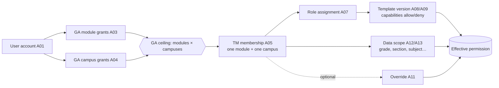

# 01 — Roles and personas

**Status:** Design direction (working assumption, expected to change), 18 Oct 2026 · Closes gap G2 · Working answer to Architecture open question #9 · Decision record: [DL-02](./06-decision-log.md#dl-02--personas-map-to-gatm-constructs)

> This mapping lets design start now. It is not part of the architecture until DL-02 is confirmed; when it changes, update this file and add a superseding entry in `06-decision-log.md`.

**Tóm tắt (VI):** 5 persona của Admin Platform, mỗi persona được map chính xác sang GA grant (trần quyền), TM membership + access role + template (quyền vận hành) và data scope (phạm vi dữ liệu). Quy tắc nền: **persona ≠ HR position ≠ access role ≠ academic role**.

## Four things that are easy to confuse

| Concept | Lives in | Example | Grants access? |
|---|---|---|---|
| **HR position** | E05 Job Position via E04 | "Mathematics Teacher", "Principal" | No |
| **Campus affiliation** | E07 Employee Campus Assignment | Priya works at SG-PGL and SG-ECS | No (BR-06) |
| **Academic role** | entity D01 / D02 (Academic Allocation) | Class teacher of 7B; teaches Maths 6–8 | No (feeds data scope suggestions only) |
| **Access** | A03/A04 GA grants → A05 TM membership → A07 role → A10 template → A12/A13 scope | Attendance and Conduct @ SG-PGL as `TEACHER`, scope = sections 7B, 7C | **Yes** |

A **persona** is a design concept: a typical bundle of the above. The system never stores "persona"; it stores grants, memberships, roles and scope.

## How access is evaluated (the two-layer model)

A user can act on a record only when **all** hold: active GA module grant, active GA campus grant, active TM membership for that module + campus, a role whose template allows the capability, and a data scope that includes the record. See DL-07 for combination rules.

## Access role catalog (A06) — proposed values

| `role_code` | `role_category` | `module_id` | Purpose |
|---|---|---|---|
| `GLOBAL_ADMIN` | SYSTEM | null | Manage GA grants, catalogs, campuses, templates |
| `PLATFORM_AUDITOR` | SYSTEM | null | Read-only audit log and access reports across campuses |
| `HR_ADMIN` | FUNCTIONAL | Staff and HR | Create and maintain employee master data |
| `HR_VIEWER` | FUNCTIONAL | Staff and HR | Read directory and profiles (no Confidential edit) |
| `MODULE_ADMIN` | FUNCTIONAL | any campus module | Run the module's team: members, roles, scope |
| `CAMPUS_LEADER` | FUNCTIONAL | Governance | Campus-wide read, approve access requests and reviews |
| `TEACHER` | FUNCTIONAL | Attendance and Conduct, Teaching and Learning, Assessment and Reporting, Communication and Cases | Teaching-side capabilities, scoped to own sections/subjects |
| `MEMBER` | FUNCTIONAL | any | Generic module member (non-teaching staff) |
| `VIEWER` | FUNCTIONAL | any | Read-only within scope |

Every employee with an active linked account also gets **self-service** (My profile, My access) without a grant; it is not a role and cannot be revoked separately from the account.

## Personas

### P1 — HR Admin

| | |
|---|---|
| Example | Meera Iyer, Global HR Admin, GRP-HQ (global) · or a campus HR Executive at SG-PGL (campus) |
| Architecture roles mapped | None directly: the handbook names no HR role (it is a student handbook). Assumed HR team per country plus a group HR lead |
| Goals | Every employee has exactly one correct, current record; onboarding and exits are on time |
| Pain today | Duplicate people across campuses and contracts; no history when someone changes role |
| GA module grants | Staff and HR |
| GA campus grants | Global HR: all campuses · Campus HR: own campus |
| TM membership | Staff and HR @ each granted campus, role `HR_ADMIN` |
| Template | `hr.admin.standard` (v1) |
| Data scope | `CAMPUS` = granted campuses; `ORG_UNIT` optional |
| Owns (CRUD) | E01, E02, E04, E07; reads E03, E05, E06 |
| Cannot | Grant GA access, edit templates, change TM memberships in other modules (separation of duties, DL-09) |
| Key screens | SCR-HR-01…10, SCR-GOV-01 (exit/transfer items assigned to HR) |
| Device | Desktop web |

### P2 — Global Admin

| | |
|---|---|
| Example | Daniel Tan, Group IT, GRP-HQ |
| Architecture roles mapped | Group leadership delegates (platform owner); not a school role |
| Goals | The outer boundary of access is right, catalogs are clean, nothing is granted without a reason |
| GA grants | System role `GLOBAL_ADMIN` (implicitly all modules and campuses for admin functions only; it does **not** imply module data access) |
| TM membership | None needed; may hold memberships like any user if they also work in a module |
| Owns (CRUD) | A01 status, A02, A03, A04, A06, A08/A09 publish, R01, R02, E06 |
| Reads | E01/E02 summary (Internal fields only), all TM memberships (read), A14 |
| Cannot | Edit HR master fields; approve their own grant (four-eyes on GLOBAL_ADMIN grants, DL-09) |
| Key screens | SCR-GA-01…10, SCR-GOV-01…04 |
| Device | Desktop web |

### P3 — Campus Leader

| | |
|---|---|
| Example | Dr Anita Rao, Principal, SG-PGL |
| Architecture roles mapped | Campus Principal / Vice Principal / Deputy Principal; Academic Supervisor (read-only variant); Country Director (country-level variant) |
| Goals | Know who works on my campus and who can see my students' data; approve exceptions quickly |
| GA grants | Governance module + every module used on campus (read) · campus = own campus (Country Director: all campuses in country) |
| TM membership | Governance @ SG-PGL, role `CAMPUS_LEADER`; `VIEWER` in campus modules |
| Data scope | `CAMPUS` = own; `SECTION` for VP/Deputy (e.g. Primary) |
| Owns | Approves access requests and access reviews for own campus; attests periodic reviews |
| Reads | Employee directory for campus (Internal + Confidential contact, not Restricted), all memberships on campus, campus audit trail |
| Key screens | SCR-CL-01, SCR-GOV-01/02, SCR-HR-02/03 (read), SCR-GA-04 (read, own campus) |
| Device | Desktop + tablet; approvals on mobile |

### P4 — Module Admin

| | |
|---|---|
| Example | Kenji Lim, Attendance and Conduct admin, SG-PGL (often a Programme Coordinator or Admin Officer by HR position) |
| Architecture roles mapped | Programme or level coordinator, Transport executive, Nurse lead, ECA in-charge, Finance Controller — whoever runs a module's team on a campus |
| Goals | Put the right people in my module with the right role and scope, without waiting for IT |
| GA grants | The module · their campus |
| TM membership | The module @ campus, role `MODULE_ADMIN` |
| Owns (CRUD) | A05 (in own module + campus), A07, A10, A12/A13, A11 if enabled |
| Bounded by | Can only add users who already have the GA module + campus grant (BR-15); otherwise raises an Access Request to Global Admin |
| Key screens | SCR-TM-01…05, SCR-ME-02 (on behalf), SCR-GOV-01 (items in own module) |
| Device | Desktop web |

### P5 — Teacher

| | |
|---|---|
| Example | Priya Nair, CBSE 6–8 Mathematics, primary campus SG-PGL, also teaches at SG-ECS on Wednesdays |
| Architecture roles mapped | Class teacher, Subject teacher (also Counsellor / Nurse as non-teaching staff with the same self-service pattern) |
| Goals | Sign in once and see the right classes on every campus I teach at; fix my own contact details |
| GA grants | Attendance and Conduct, Teaching and Learning, Assessment and Reporting, Communication and Cases · campuses SG-PGL, SG-ECS |
| TM memberships | One per module per campus, role `TEACHER` |
| Data scope | `SECTION` + `SUBJECT` for AY 2026-27, suggested from academic allocations (entity D02) and confirmed by Module Admin |
| Owns | Own `preferred_name`, `work_phone`, `preferred_locale`, photo (self-service, if Decision D01 allows) |
| Key screens | SCR-ME-01, SCR-ME-02, SCR-SYS-01, SCR-AUTH-01 |
| Device | Mobile-first for self-service; desktop for module work |

## Persona × capability matrix (admin slice)

`●` full · `◐` within own scope · `○` read · `—` none · `R` request/approve only

| Capability (R02 code) | HR Admin | Global Admin | Campus Leader | Module Admin | Teacher |
|---|---|---|---|---|---|
| `hr.employee.view` | ◐ | ○ (Internal) | ◐ | ○ (own module members) | self |
| `hr.employee.create` / `.update` | ◐ | — | — | — | self (contact) |
| `hr.employment.end` | ◐ | — | — | — | — |
| `hr.campus_assignment.manage` | ◐ | — | — | — | — |
| `hr.confidential.view` | ◐ | — | ◐ (contact only) | — | self |
| `ga.module_grant.manage` / `ga.campus_grant.manage` | R | ● | R (approve) | R | R |
| `ga.catalog.manage` (R01, R02, A06, E06) | — | ● | — | — | — |
| `ga.template.publish` | — | ● | — | R (propose) | — |
| `tm.membership.manage` | — | ○ | ○ | ◐ | — |
| `tm.scope.manage` | — | ○ | ○ | ◐ | — |
| `gov.access_review.decide` | ◐ (HR items) | ● | ◐ | ◐ (own module) | — |
| `gov.audit.view` | ◐ (HR events) | ● | ◐ | ◐ (own module) | self |
| `gov.report.export` | ◐ | ● | ◐ | — | — |

## Architecture roles not yet personas

Group leadership, Country Director, Finance Controller, Academic Supervisor, Coordinators, Counsellor, Admissions, Transport, Nurse, ECA in-charge, Security, Discipline committee, Parent, Student. In the admin slice they are **users who hold memberships**, not designers' personas. Each becomes a persona when its own module is designed. Parents and students never see the Admin Platform.
