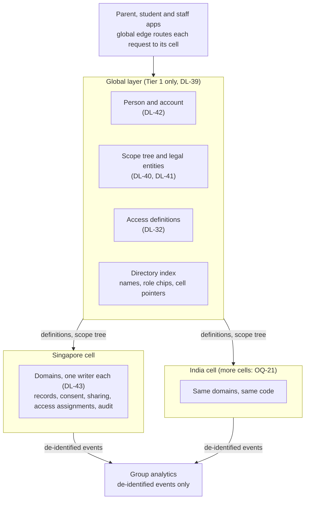

# Data architecture (Layer 0 for design)

**Status:** Confirmed (DL-39…DL-46, Henry, 7 Nov 2026); builds on Architecture v1 (Proposed) · **Owner:** Henry
**Cites:** [Architecture v1](../00-sources/Global_Campus_OS_Product_Architecture_v1.md) § Multi-campus and tenancy model, § High-level data model, § System architecture, § Security · DL-11, DL-19, DL-22, DL-24, DL-32…DL-46 · OQ-06, OQ-07, OQ-09, OQ-10, OQ-20, OQ-21, OQ-43
**Tóm tắt (VI):** Kiến trúc dữ liệu của Campus OS ở dạng AI design workflow đọc được: lớp toàn cầu chỉ giữ danh tính, mỗi quốc gia một cell; cây phạm vi có Brand; một Person nhiều hồ sơ; mỗi entity một nơi ghi. 14 quy tắc AR và 14 mẫu giao diện AP được nạp cho mọi màn hình.

This file is **Layer 0** of the design workflow (DL-46): load it before any object card or slice. Layer 1 is [`objects/`](./objects/README.md); Layer 2 is [`../06-experience/`](../06-experience/README.md). The data dictionaries stay the engineering source; this file and the object cards are their design view.

## Shape

## Organisation and tenancy (DL-40, DL-41)

| Level | Example (GIIS) | Owns and can override |
|---|---|---|
| Group | GSG | Programme pack masters, group policies, module catalogue |
| Brand | GIIS | Brand identity, brand policy templates, brand-wide roles |
| Brand-country | GIIS Singapore | Regulator pack, currency and tax, holidays, fee protection; its country code selects the data cell |
| Campus | SMART Campus Punggol | Calendar, fee plans, rooms, routes, escalation owners |
| Segment | Primary (DL-29) | School day timings, segment events |
| Programme offering | CBSE 6–8 at Punggol | Subjects, grading scale and promotion rule versions |

- **Legal entities sit beside the tree.** Campus operator is an effective-dated link from campus to operating entity. Enrolment, employment and cases copy `operating_entity_id` at creation; it is the controller slot and stays unnamed until OQ-06.
- **Every row carries** `tenant_path` (group/brand/brand-country/campus), `cell`, `operating_entity_id` where a school act created it, `valid_from` / `valid_to`, and a tier on each field.
- Which settings a school may override stays open (OQ-20).

## People (DL-42)

One Person per human (global, Tier 1) with Student, Guardian and Employee profiles in cells and one account. Domain keys (`student_id`, `employee_id`) link to `person_id`. Duplicates go to a review queue; matching uses IDs, never names or emails.

## Domains and ownership (DL-43)

Thirteen domains, each the single writer of its entities: Tenancy and config, Identity and Access Registry, Academic structure, Admissions, Student Records, Staff and HR, Teaching, Assessment, Attendance and conduct, Wellbeing, Fees and finance, Engagement, Platform services. The object registry in [`objects/README.md`](./objects/README.md) lists each object's owner.

## Governance records (DL-44)

| Record | Holds | Open legal slot |
|---|---|---|
| Operating entity on the record | `operating_entity_id` on enrolment, employment, cases | Controller (OQ-06) |
| Consent | Subject, given by, purpose, status (given, refused, withdrawn, not required), evidence, valid dates | What it must hold per country (OQ-10) |
| Purpose catalogue | Code, description, whether consent is needed | Lawful basis (OQ-09) |
| Sharing record | From entity, to entity, people, data set, reason, approver, date | Authority to share (OQ-07) |
| Retention policy | Per country pack and record type: keep for, then anonymise or delete | Periods (OQ-43) |

**Movement.** A transfer inside a cell ends one enrolment and starts another (DL-24; Student ID kept, DL-31). A transfer across cells creates the profile in the target cell under a sharing record; the origin keeps history until retention ends. Group analytics get de-identified events only (OQ-08). Tier 3 never leaves its cell raw, never rides an event payload and never goes to an AI model.

## Migration and events (DL-45)

Legacy systems stay authoritative per field group until each cutover date, recorded in an authority register. External IDs live in mapping tables (ST10, E08). Conflicts are quarantined, never merged silently. Events go through a transactional outbox, one per fact, carrying IDs and `tenant_path` only.

## Architecture rules (AR)

Loaded with every screen. Each rule names the pattern that expresses it.

| ID | Rule | What every screen must do | Pattern | Basis |
|---|---|---|---|---|
| AR-01 | Global knows who; each country cell holds what | Cross-cell views show de-identified counts unless the viewer has cell access | AP-08 | DL-39 |
| AR-02 | Scope tree is Group › Brand › Brand-country › Campus › Segment or Programme offering | Show the current scope in the shell and breadcrumb on every staff screen | AP-01 | DL-40 |
| AR-03 | Settings inherit downward and are effective-dated | Show where a value comes from and whether this level may override it | AP-02 | Arch § Tenancy, OQ-20 |
| AR-04 | Every school record carries its operating entity; the controller stays unnamed until OQ-06 | Never name a controller; use the placeholder | AP-09 | DL-41 |
| AR-05 | One Person, many profiles, one login | One person header with role chips; one Staff / Parent / Student switch | AP-03 | DL-42 |
| AR-06 | One writer per entity | Fields owned by another domain are read-only with a source chip and a link to the owner | AP-04 | DL-43 |
| AR-07 | Nothing is overwritten; changes carry valid dates | Edits ask "from when"; history is one click away | AP-05 | DL-24 |
| AR-08 | Every field has a tier | T2 only with the capability; T3 masked, revealed with a reason, and logged | AP-06 | DL-11, DL-19, DL-34 |
| AR-09 | Relationships aren't access; only the Access Registry grants it | Restricted elements answer "Why can I see this?"; no access is a designed state | AP-07 | BR-06, DL-32, DL-38 |
| AR-10 | Purpose and consent are records | Ask for a purpose only on T3 reveal, cross-cell access and support sessions; show consent status where processing depends on it | AP-10 | DL-44, OQ-09, OQ-10 |
| AR-11 | Data crossing an entity or cell needs a sharing record | Transfers show what moves, to whom and who approved it | AP-11 | DL-44, OQ-07 |
| AR-12 | Legacy systems are authoritative per field until cutover | Source chip names the system; conflicts go to a review queue | AP-04, AP-12 | DL-45 |
| AR-13 | Open items are never designed as settled | Keep the element generic, mark it pending, cite the OQ in a comment | AP-13 | CONVENTIONS |
| AR-14 | Each object has one lifecycle vocabulary | Status chips use the object card's states and colours only | AP-14 | DL-10 |

## Architecture UI patterns (AP)

Machine-readable copy: [`design-tokens/patterns/architecture-patterns.json`](../../design-tokens/patterns/architecture-patterns.json). AP-06 is the existing P-LOCK in [rules-to-ui](../06-experience/admin-platform/rules-to-ui.md).

| ID | Pattern | Looks like | MinV parts | States |
|---|---|---|---|---|
| AP-01 | Scope switcher and breadcrumb | "GIIS · Singapore · Punggol" in the app bar; picker limited to nodes the viewer holds | sidebar-nav, page-header, breadcrumb | One node, many nodes, no scope |
| AP-02 | Inheritance indicator | "Inherited from GIIS Singapore" under a value; "Override" only where allowed | form-section, chip soft | Inherited, overridden, locked by group |
| AP-03 | Person header and context switch | Avatar, name, role chips; account menu switch | detail-header, avatar, menu | One role, several roles |
| AP-04 | Source chip and read-only field | Field disabled, chip "From MyGIIS" or "From Staff and HR", link to the owner | text field disabled, chip soft info | Owned here, owned elsewhere, legacy |
| AP-05 | Effective-dated history | "Valid from" on edit; history drawer as a timeline; future change shown as scheduled | timeline, date-picker, drawer | Current, scheduled, ended |
| AP-06 | Tier lock (P-LOCK) | Masked value, lock icon, "Reveal" asks a reason and logs | rules-to-ui P-LOCK | Visible, masked, revealed, hidden |
| AP-07 | Access explainer | "Why can I see this?" popover naming the grant, link or ACL; no-access page naming who to ask | popover, empty-state | Allowed, denied, acting for |
| AP-08 | Aggregate-only view | KPI cards captioned "De-identified"; drill-down disabled outside the viewer's cells | stats-row, chart-card | Aggregate, drill-down allowed |
| AP-09 | Controller placeholder | "[data controller — OQ-06]" in notices, consent and exports | caption text | Placeholder until OQ-06 |
| AP-10 | Purpose prompt and consent chip | Dialog with a purpose picker; chip "Consent given / refused / not required" | dialog, chip | Given, refused, withdrawn, not required |
| AP-11 | Transfer and sharing review | Stepper: what moves, from which entity and cell, to which, approver | stepper, form-section | Draft, awaiting approval, approved, moved |
| AP-12 | Conflict quarantine | Side-by-side diff of Campus OS and legacy values, accept or reject | listDetailShell, table | Open, resolved |
| AP-13 | Pending marker | Outlined warning chip "Pending" plus an HTML comment citing the OQ | chip outlined warning | Pending |
| AP-14 | Status chip | One chip per lifecycle state, colour from the object card | badge-status | Per object |

## Screen request contract

Every Campus OS screen prompt declares:

1. **Screen:** the `SCR-` ID from the slice screen map, and the screen type from `prompts/context-map.json`.
2. **Viewer:** persona, access role and scope node (for example P3 Campus Leader at GIIS › GIIS Singapore › Punggol).
3. **Objects:** the `OBJ-` IDs shown, primary first.
4. **States:** which of empty, loading, error, no access, masked and success to render.
5. **Sample:** the record set from the slice README or the card's `sample`.
6. **Variation:** the brand, country or campus that differs, if any (MC IDs).

Every output carries an HTML comment listing the AR, AP, OBJ, DL and OQ IDs it applied; a pending marker on every element that depends on an open OQ; no field, state or label that isn't on the object card; the scope shell on every staff screen; masking on every T3 field.

**Review checklist:** IDs listed; states match the card; owned-elsewhere fields read-only; T3 masked; nothing open shown as settled.
