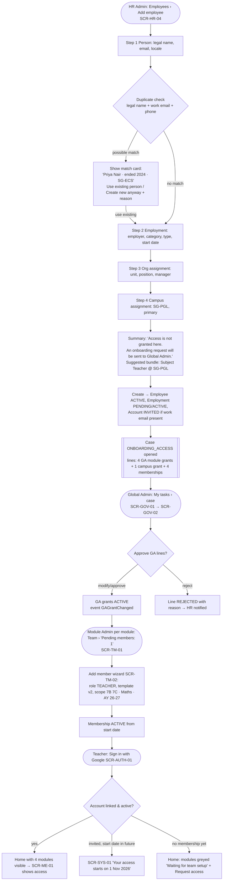
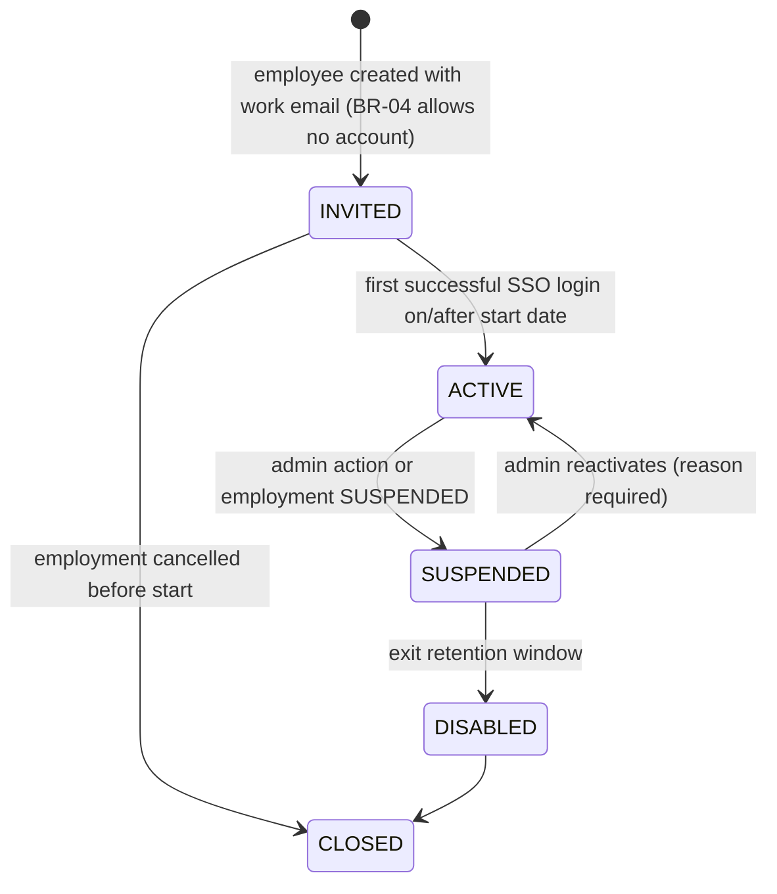

# S1 — Onboard a new teacher to first login

**Persona:** HR Admin (Meera) → Global Admin (Daniel) → Module Admins (Kenji and others) → Teacher (Priya)
**Screens:** SCR-HR-04, SCR-HR-03, SCR-GOV-01, SCR-GOV-02, SCR-GA-05, SCR-TM-01, SCR-TM-02, SCR-AUTH-01, SCR-ME-01, SCR-SYS-01
**Rules:** BR-01, BR-04, BR-05, BR-06, BR-07, BR-12, BR-13, BR-15, BR-19 · Decisions D01, D02, D05

**Tóm tắt (VI):** HR tạo hồ sơ → hệ thống tạo yêu cầu cấp quyền (không tự cấp) → Global Admin duyệt GA grant → Module Admin thêm membership + scope → giáo viên đăng nhập Google lần đầu.

## Flow

## States

**User Account (A01) during onboarding**

**Employment (E02):** `PENDING` (start date in future) → `ACTIVE` (on start date, automatic) → see S3.

## Screen states

| Screen | Empty | Loading | Error / validation | No access | Success |
|---|---|---|---|---|---|
| SCR-HR-04 step 1 | — | Duplicate check spinner inline under name fields | Required: legal first name; email format; "Possible duplicate" warning card (non-blocking, needs reason to continue) | Wizard hidden without `hr.employee.create`; button absent on SCR-HR-02 | — |
| SCR-HR-04 step 2 | — | — | Start date required; end date ≥ start date (BR-13); employee number unique per employer | — | — |
| SCR-HR-04 step 4 | Campus list empty → "No active campuses. Ask Global Admin to add one." | — | Overlap with existing assignment at same campus (BR-14) blocks | Only campuses in HR Admin's own scope listed | — |
| SCR-HR-04 summary | — | "Creating record…" full-width progress | Server conflict (row_version) → "Someone else edited this person. Reload." | — | Toast "Priya Nair created. Onboarding request sent to Global Admin." + link to profile |
| SCR-GOV-02 | "No open requests" illustration | Skeleton lines | Line apply failure shows per-line error chip, case stays IN_REVIEW | Read-only if not decider | Banner "Applied 5 of 5 changes" |
| SCR-TM-01 | "No members yet. Add the first member." | Table skeleton | — | Team tab hidden unless MODULE_ADMIN | Pending-members banner disappears |
| SCR-TM-02 person picker | "No eligible people. People need module and campus access first." + Request access | Search spinner | Person without GA grant: row disabled with "No access to *Attendance and Conduct* at *SG-PGL*" + "Request" (BR-15) | — | Toast "Priya Nair added as Teacher" |
| SCR-AUTH-01 | — | Redirecting to Google | "Your Google account isn't linked to a GIIS staff record. Contact HR." / "Your account is suspended." | — | Redirect to Home |

## Notifications

| When | To | Channel | Message |
|---|---|---|---|
| Case opened | Global Admin(s) | in-app + email | "Onboarding: Priya Nair, Subject Teacher, SG-PGL, starts 1 Nov. 5 access changes to review." |
| GA lines applied | Module Admins of granted modules | in-app | "Priya Nair is ready to join *Attendance and Conduct* at SG-PGL." |
| Membership added | Teacher | email (to work email) | "You're set up. Sign in with Google on 1 Nov." |
| Line rejected | HR Admin who created | in-app | "Request for *Fees and Finance* was rejected: not needed for teaching role." |
| SLA breach (2 working days) | Decider's manager | in-app | escalation |
