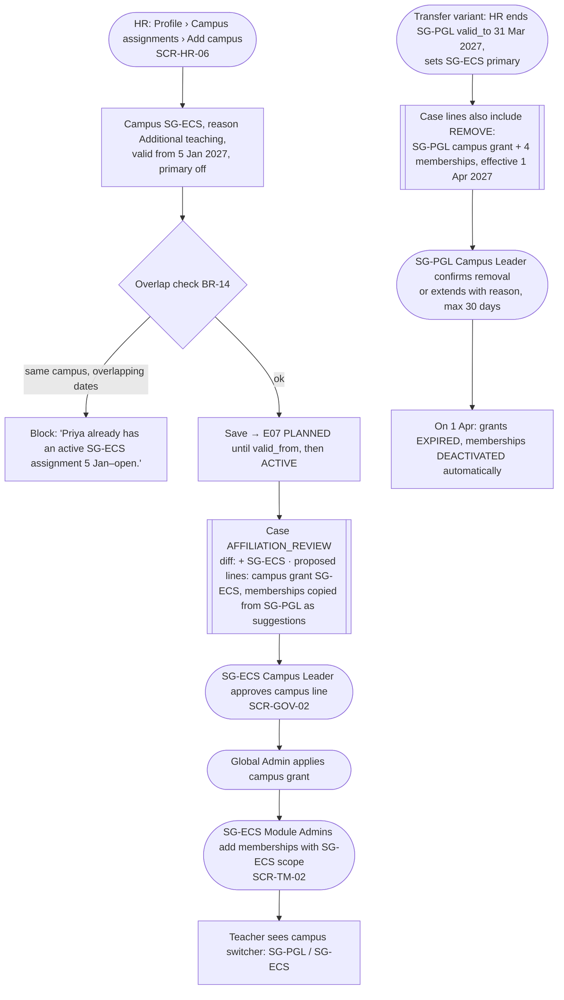
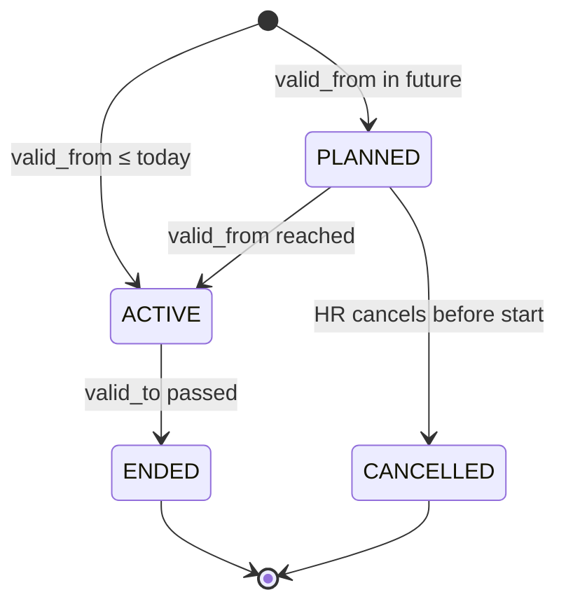

# S2 — Add a second campus / transfer a teacher

**Persona:** HR Admin → Campus Leaders (target and source campus) → Global Admin → Module Admins
**Screens:** SCR-HR-03 (Campus assignments tab), SCR-HR-06, SCR-GOV-01, SCR-GOV-02, SCR-GA-04, SCR-TM-02, SCR-CL-01
**Rules:** BR-02, BR-03, BR-06, BR-13, BR-14, BR-15 · Decisions D04, D07

**Tóm tắt (VI):** Thay đổi campus là sự kiện HR, **không** tự động thêm hay bớt quyền. Hệ thống mở Affiliation Review: campus mới cần duyệt để cấp quyền, campus cũ được đề xuất gỡ quyền theo ngày hiệu lực.

## Flow

## States — Employee Campus Assignment (E07)

Primary flag: at most one ACTIVE primary per employment is the default but not enforced (Decision D04); if none, the profile shows "No primary campus" (info chip), never an error. Group Office staff may have none.

## Screen states

| Screen | Empty | Error / validation | No access | Success |
|---|---|---|---|---|
| SCR-HR-03 Campus assignments tab | "No campus assignment. Add one so this person appears in campus lists." | — | Campus Leader sees own-campus rows; others collapsed as "+1 other campus" | — |
| SCR-HR-06 | — | `valid_to < valid_from` inline error (BR-13); overlap block (BR-14); setting primary while another is primary → confirm "Make SG-ECS primary and unset SG-PGL?" | Only campuses in HR scope | Persistent notice in drawer footer: "This doesn't change access. An affiliation review will open." Then toast with link to case |
| SCR-GOV-02 (affiliation) | — | Approving a membership line before the campus grant line → line disabled "Needs campus grant first" | Source and target leaders each see only their campus lines | Diff panel: green "+ SG-ECS" / red "− SG-PGL (from 1 Apr)" |
| SCR-CL-01 | "No incoming or outgoing staff this term" | — | — | Card "Incoming staff (2) · Outgoing (1)" |

## Edge cases

- **Ending the last campus assignment while employment is active:** allowed, warning "Priya will have no campus. She won't appear in any campus list."
- **Back-dated assignment** (valid_from in the past): allowed for HR with reason; review case marks effective date "already passed" in amber; access is never back-dated.
- **Cross-country transfer (SG → IN):** different employer → HR is told "This is a new employment with GIIS India" and routed to *End employment* + *Add employment* (Decision D03 default) rather than a campus change.
