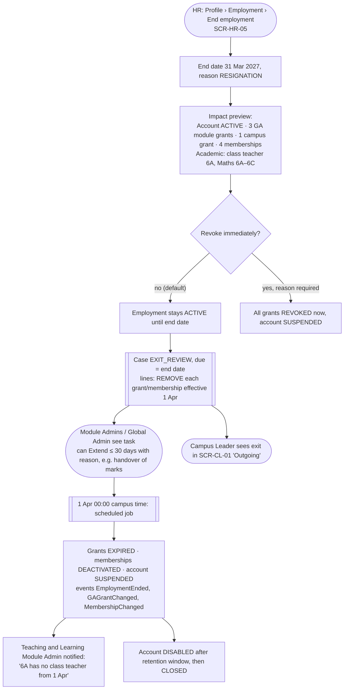
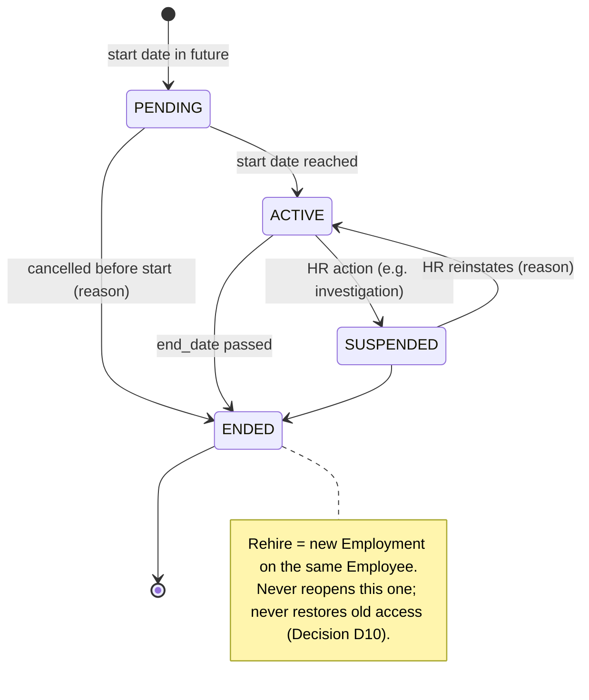

# S3 — Employee exit and access revocation

**Persona:** HR Admin → system → Global Admin / Module Admins → Campus Leader
**Screens:** SCR-HR-03, SCR-HR-05, SCR-GOV-01, SCR-GOV-02, SCR-GA-04, SCR-HR-01 (upcoming exits), SCR-TM-01
**Rules:** BR-03, BR-05, BR-10, BR-12 · Decisions D10, D12

**Tóm tắt (VI):** Nghỉ việc = HR đặt ngày kết thúc. Hệ thống mở Exit Review, mặc định **tự động gỡ toàn bộ quyền vào ngày end_date + 1**. Không tự kích hoạt lại khi tái tuyển dụng.

## Flow

## States — Employment (E02)

Employment SUSPENDED → account SUSPENDED (proposed cascade, DL-13). Account changes never change employment (BR-05).

## Screen states

| Screen | Error / validation | Success / feedback |
|---|---|---|
| SCR-HR-05 | End date required; end date before start date blocked; end date > 90 days ahead → warning "Exits are usually entered within 90 days" | Toast "Exit recorded. Access will end on 1 Apr 2027." + link to case |
| SCR-HR-03 header | — | Status chip "Leaving 31 Mar" (warning) until end date, then "Ended" (default grey) |
| SCR-GOV-02 extend | Extension > 30 days blocked; reason required | Line shows "Extended to 30 Apr by Kenji Lim" |
| SCR-HR-01 | — | KPI "Upcoming exits (30 days): 4" → filtered directory |
| SCR-GA-04 for ended user | All tabs read-only, banner "Employment ended 31 Mar 2027. Access ended 1 Apr 2027." | — |
| Rehire on SCR-HR-04 | Duplicate check finds ended person → "Rehire Rahul Verma" path; summary says "Previous access will not be restored." | New Employment row in timeline; old ones kept |
