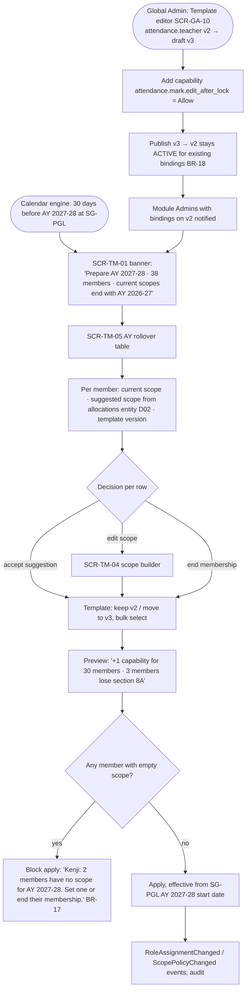
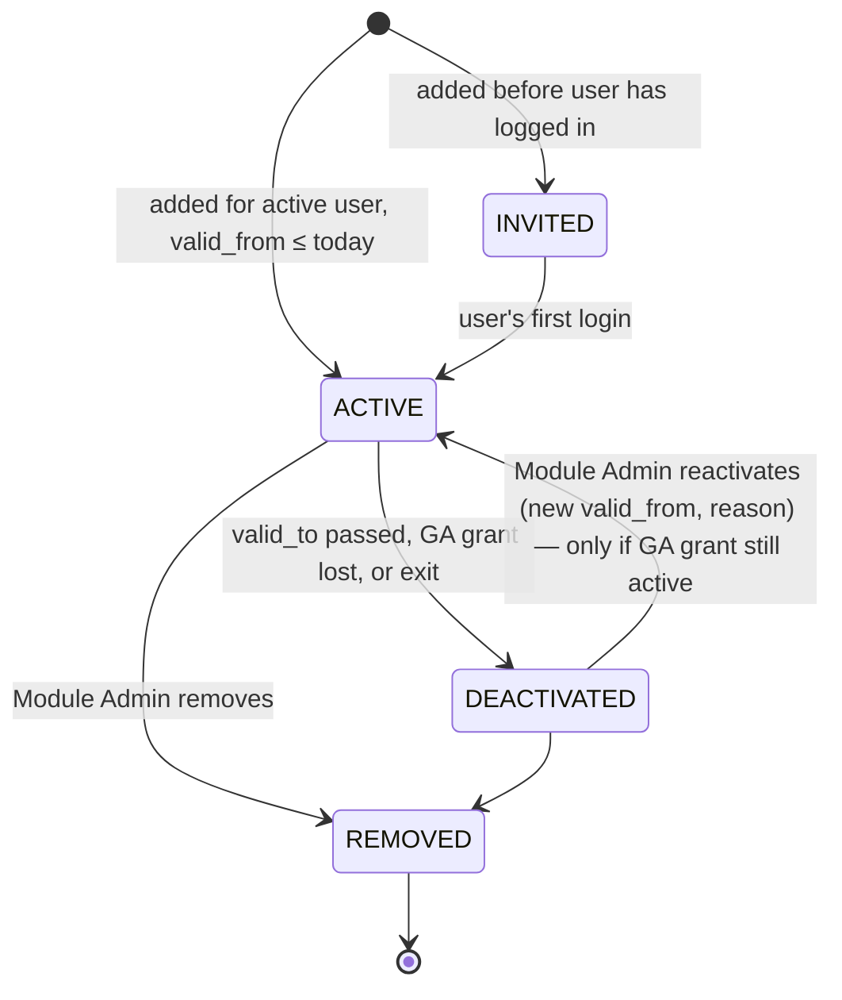
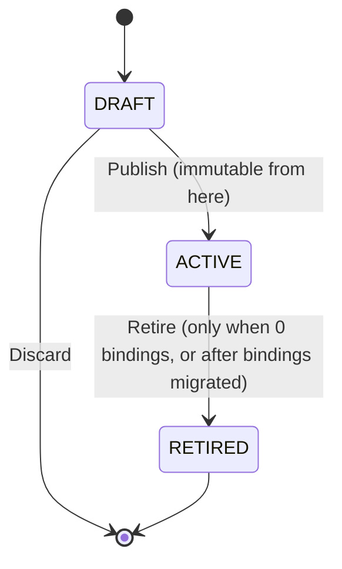

# S4 — Set up a module team for the new academic year

**Persona:** Module Admin (Kenji, Attendance and Conduct @ SG-PGL) · Global Admin (publishes template) · Teacher (affected)
**Screens:** SCR-GA-10, SCR-GA-09, SCR-TM-01, SCR-TM-03, SCR-TM-04, SCR-TM-05, SCR-SYS-01
**Rules:** BR-07, BR-08, BR-15, BR-16, BR-17, BR-18 · Decisions D08, D09, D11, D14

**Tóm tắt (VI):** Trước năm học mới, Module Admin chuyển team sang AY mới: scope gợi ý từ phân công giảng dạy, chọn có nâng template lên version mới không, xem trước thay đổi quyền rồi áp dụng theo ngày bắt đầu năm học.

## Flow

## States

**TM Membership (A05)**

**Permission Template version (A08)**

## Screen states

| Screen | Empty | Error / validation | No access | Success |
|---|---|---|---|---|
| SCR-GA-10 | New template: "Start from blank or copy from an existing template" | Editing an ACTIVE version → editor opens read-only with "Create v4 draft"; capability set to both Allow in one template and Deny in an ADD_ON → info "Deny wins (DL-07)" | Module Admin sees read-only | "v3 published. 38 bindings still on v2." |
| SCR-TM-01 | "No members yet" | GA grant expired for a member → row amber "Access ceiling removed. Membership will deactivate." (BR-07) | Team tab hidden | — |
| SCR-TM-04 | First condition prompt "Who should this member see?" | No condition → Save disabled, helper "A member with no scope sees nothing" (BR-17); condition referencing previous AY → warning | — | Live preview "Matches 2 sections · 61 students" |
| SCR-TM-05 | "No members to roll over" | Rows without scope highlighted error; apply blocked | — | Summary: "Applied to 36 members, ended 2" |
| SCR-TM-03 Overrides tab | Hidden entirely if overrides are disabled (Decision D09 default) | Override that exceeds GA ceiling → not selectable (BR-16); reason required | — | Override chip on member row |
| SCR-SYS-01 (teacher, day 1 of AY, scope not set) | — | — | "You don't have any classes in *Attendance and Conduct* for AY 2027-28 yet. Kenji Lim manages this team." + Request access | — |
