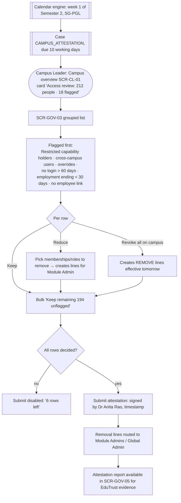
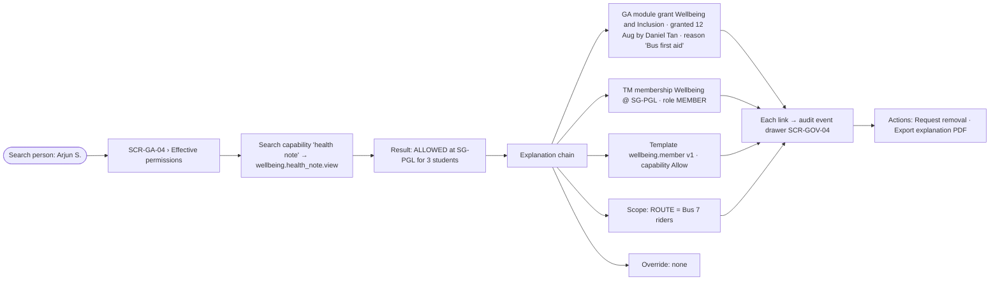

# S5 — Campus access review and "why can they see this?"

**Persona:** Campus Leader (Dr Anita Rao, SG-PGL) · Global Admin · Platform Auditor
**Screens:** SCR-CL-01, SCR-GOV-03, SCR-GOV-01, SCR-GA-04 (Effective permissions), SCR-GOV-04, SCR-GOV-05
**Rules:** BR-08, BR-11, BR-12, BR-16, BR-17 · Decisions D08, D12, D13

**Tóm tắt (VI):** Mỗi học kỳ, Campus Leader xác nhận ai đang có quyền trên campus mình (ưu tiên các dòng rủi ro). Khi có sự cố, mở Effective Permissions để thấy chuỗi giải thích: grant → membership → role → template → scope → override, mỗi mắt xích dẫn tới audit event.

## Flow — termly attestation

## Flow — investigation

## States — Campus attestation (Case `CAMPUS_ATTESTATION`)

Uses the shared Case lifecycle ([README](./README.md#shared-case-object-access-request--access-review)) with one extra rule: `APPROVED` means *attested*; each row decision is stored as a line. A case past due goes `ESCALATED` to the Country Director.

## Screen states

| Screen | Empty | Loading | Error | No access | Success |
|---|---|---|---|---|---|
| SCR-CL-01 | "No review due. Next review: week 1 of Semester 1." | Card skeletons | — | Campus Leader only; VP sees own section's staff | Card turns green "Attested 14 Oct" |
| SCR-GOV-03 | "No one has access to SG-PGL" (unlikely; shows CTA to Global Admin) | Table skeleton with progress bar | Submit fails → keep decisions locally, retry banner | Read-only for Auditor | Confirmation dialog with counts (kept / reduced / revoked) |
| SCR-GA-04 Effective permissions | "Search a capability to see if and why this person has it" | Inline spinner per capability | Evaluation error → "Couldn't evaluate. Showing grants only." | Campus Leader sees only rows for own campus; others "+ access at 1 other campus (hidden)" | Result badge ALLOWED (success) / DENIED (error) / NO SCOPE (warning) with chain |
| SCR-GOV-04 | "No events match these filters" | — | — | Restricted before/after values masked unless `PLATFORM_AUDITOR` or `GLOBAL_ADMIN` (BR-11) | Export toast "CSV ready (redacted)" |

## Explanation chain — design rules

1. Order is always: GA module → GA campus → Membership → Role → Template version → Scope → Override.
2. A broken link is shown in red with the reason ("Campus grant expired 1 Apr") and the result is DENIED.
3. A Deny entry anywhere shows first, with "Deny wins" chip (DL-07).
4. Scope link shows the matching condition group in plain words: "Section is 7B **or** 7C, **and** subject is Mathematics, **and** AY is 2026-27".
