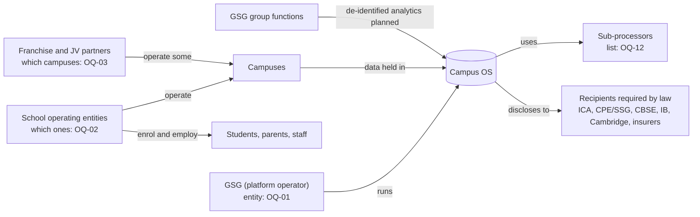

# Data controller model

**Status:** Parties and legal definitions Known; controller assignments Open, 25 Oct 2026 · **Owner:** Henry
**Cites:** RES-F02, RES-F05, RES-F07 · MC-03, MC-09, MC-10, MC-13 · research §07, §09 · [Architecture v1 § Multi-campus and tenancy model](../00-sources/Global_Campus_OS_Product_Architecture_v1.md#multi-campus-and-tenancy-model), [§ Security](../00-sources/Global_Campus_OS_Product_Architecture_v1.md#security-privacy-and-compliance) · Data Dictionary E02
**Tóm tắt (VI):** Mô hình các bên liên quan đến dữ liệu: luật định nghĩa vai trò nào, trong GSG có những bên nào, product truth đang ghi nhận gì. Bên nào là controller cho dữ liệu nào là câu hỏi pháp lý còn mở (OQ-06); file này không trả lời thay.

This model describes **who the parties are and what is known about them**. Which party is controller, processor or joint controller for which data is a legal question for DPOs and counsel (OQ-06). Designs must not show a controller assignment as settled.

## What the law defines

Both laws in product truth separate the party that decides why and how personal data is used from the party that processes it on that party's behalf. The deciding party carries the duties to give notice, get consent, keep records, answer rights requests and report breaches.

| | Singapore PDPA | India DPDP Act |
|---|---|---|
| Party that decides | Organisation | Data fiduciary |
| Party that processes on its behalf | Data intermediary | Data processor |
| Children | Anyone up to 18; teenagers may consent if they understand the notice; schools may require parental consent at higher ages (PDPC guidelines, 28 Mar 2024) | Verifiable parental consent for under-18s, using reliable ID or DigiLocker; some education and safety processing exempt (DPDP Rules, notified 14 Nov 2025; core obligations ≈ May 2027) |

Source confidence: secondary legal summaries, not legal advice (research §07). Laws in GSG's other 9 countries haven't been researched (OQ-21).

## Parties in GSG's structure

| Party | Examples | What is known | What product truth records today | Open |
|---|---|---|---|---|
| **GSG as platform operator** | The GSG entity that runs Campus OS | GSG runs the platform for all brands (Henry, DL-22) | Nothing beyond the statement | Which entity, on what contractual basis (OQ-01) |
| **School operating entities** | The entities behind GIIS Singapore, GIIS India and each acquired brand's schools | They enrol students and employ staff | One synthetic employer per country (E02 `employer_org_id`; catalog TBD; Decision D06 open) | How many, which operates each campus (OQ-02) |
| **Franchise and JV partners** | GIIS Thailand and early India campuses | Some GIIS campuses opened through local partners | Nothing | Which campuses today, data terms (OQ-03) |
| **GSG group functions** | Group HR, group academic and quality oversight, leadership dashboards | Architecture v1 plans group analytics on de-identified data only | De-identified events to group analytics | Which group purposes need identifiable data (OQ-08) |
| **Sub-processors** | Cloud host, Google Workspace, payment gateways, messaging providers | Named in Architecture v1 integrations | Integration list | List per country (OQ-12) |
| **Data subjects** | Students, parents, staff | Parents act for children under 18 in India; some teenagers can consent in Singapore | Person, Student, Guardian, Staff, Family link (Architecture data model) | How custody and guardianship are recorded (OQ-11) |
| **Recipients required by law or contract** | ICA, CPE/SSG, CBSE, IB, Cambridge, insurers | Disclosures named in the GIIS Handbook and Architecture v1 integrations | Regulator packs for SG and IN | Recipients in other countries (OQ-22) |

## Known relationships

Arrows show relationships that are known. Legal roles on them are not.

## What product truth records about data ownership

| Record | Status | Source |
|---|---|---|
| Every row carries `tenant_path` (group, country, campus) | Known | Architecture § High-level data model |
| Employment records the legal employer (`employer_org_id`) | Known | Data Dictionary E02 |
| Names, passports and health data stay in the country cell; de-identified events go to group analytics | Known | Architecture § tenancy, rbac-model Layer 6 |
| A *Consent* entity exists in the Engagement area; parents give "consents" | Known (named only, no fields) | Architecture § High-level data model, § Users and roles |
| The legal entity that controls student and family data | Not recorded | research §09 (OQ-02, OQ-06) |
| Data sharing between entities | Not modelled | research §09 (OQ-07) |
| Processing purpose on access or audit events | Not modelled | research §08 (OQ-09) |

## Data flows that depend on an open answer

These flows exist in product truth or the evidence, and each needs a controller answer before its screens can say who is responsible.

| Flow | Where it appears | Open |
|---|---|---|
| Student transfers between campuses, brands or countries | GIIS Handbook transfer policy; Architecture ("a transfer is a record move"); MC-10 | OQ-06, OQ-07 |
| Group function views campus data | Group HR, group academic leads; MC-13 | OQ-07, OQ-08, OQ-18 |
| GSG platform team supports a school | Platform operator (RES-F06) | OQ-01, OQ-15 |
| Campus changes hands or a partner leaves | Growth by acquisition; JV and franchise campuses | OQ-04 |
| Parent consents or refuses (DPDP, APAAR "refused") | RES-F05; MC-09 | OQ-10 |
| Data goes to a regulator, board or insurer | Architecture § Integrations | OQ-22 |

## For design

- Don't name a controller, fiduciary or processor in notices, consent screens or audit exports until OQ-06 is answered. Use the placeholder "[data controller — OQ-06]" in mocks.
- Employer is not the data controller. Don't reuse the employer field to answer "who owns this data".
- Tier 3 data never goes to an AI model (Architecture § Security). See [data-classification.md](./data-classification.md).
