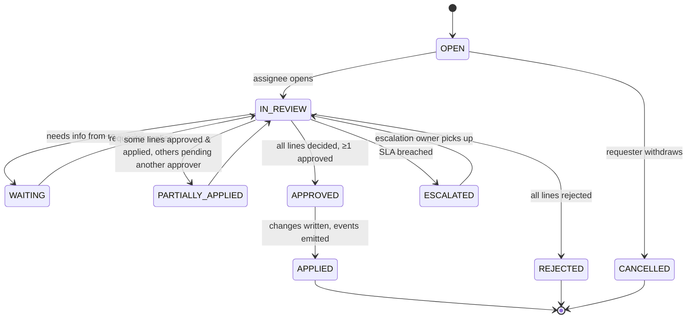

# Admin Platform — flows

**Tóm tắt (VI):** Mỗi file là một kịch bản trong `scenarios.md`: user flow (ai làm gì, ở màn hình nào), state machine của object chính, và bảng state UI (empty / loading / error / no access / success) cho từng màn hình.

| File | Scenario | Main object whose state is tracked |
|---|---|---|
| [S1-onboard-teacher.md](./S1-onboard-teacher.md) | Onboard a new teacher to first login | Onboarding Access Request (Case) + User Account |
| [S2-campus-transfer.md](./S2-campus-transfer.md) | Add a second campus / transfer | Employee Campus Assignment + Affiliation Review (Case) |
| [S3-employee-exit.md](./S3-employee-exit.md) | Employee exit and revocation | Employment + Exit Review (Case) |
| [S4-module-team-setup.md](./S4-module-team-setup.md) | Module team for a new academic year | TM Membership + Permission Template version |
| [S5-access-review.md](./S5-access-review.md) | Campus access review and investigation | Campus Attestation (Case) |

## Conventions

- Diagrams are Mermaid (`flowchart` for flows, `stateDiagram-v2` for states) so they render on GitHub and can be read by AI tools.
- Screen IDs (`SCR-…`) are defined in [`ia-screen-map.md`](../ia-screen-map.md); rule IDs (`BR-…`, `Decision D…`) in [`rules-to-ui.md`](../rules-to-ui.md).
- Status labels and colours come from [`rules-to-ui.md § Status vocabulary`](../rules-to-ui.md#status-vocabulary).

## Shared Case object (Access Request / Access Review)

All five scenarios use the architecture's single **Case** object (Architecture § High-level data model) with two new types. This is a proposal (DL-08).

| Field | Meaning |
|---|---|
| `case_type` | `ACCESS_REQUEST`, `ONBOARDING_ACCESS`, `AFFILIATION_REVIEW`, `EXIT_REVIEW`, `CAMPUS_ATTESTATION` |
| `subject_user_id` / `subject_employee_id` | Who the case is about |
| `campus_id`, `module_id` | Scope of the decision (module optional) |
| `lines[]` | Proposed changes: `{kind: GA_MODULE / GA_CAMPUS / TM_MEMBERSHIP / ROLE / SCOPE, action: ADD / REMOVE / CHANGE, target, effective_from, decision}` |
| `assignee` | Resolved by routing table below |
| `due_at` | SLA timer (working days by campus calendar) |
| `status` | see state machine |

**Routing (who decides each line)**

| Line kind | Decider | SLA (working days) |
|---|---|---|
| GA module or campus grant | Global Admin; for a campus grant the target campus's Campus Leader approves first | 2 |
| GA grant of `GLOBAL_ADMIN` | A second Global Admin (four-eyes) | 1 |
| TM membership / role / scope | Module Admin of that module + campus | 2 |
| Removal on exit | Applied automatically at `end_date + 1` unless a decider extends | n/a |
| Campus attestation | Campus Leader | 10 (first two weeks of semester) |

Escalation: past SLA → the decider's manager (E04 `manager_assignment_id`) is notified; past 2× SLA → Global Admin.
